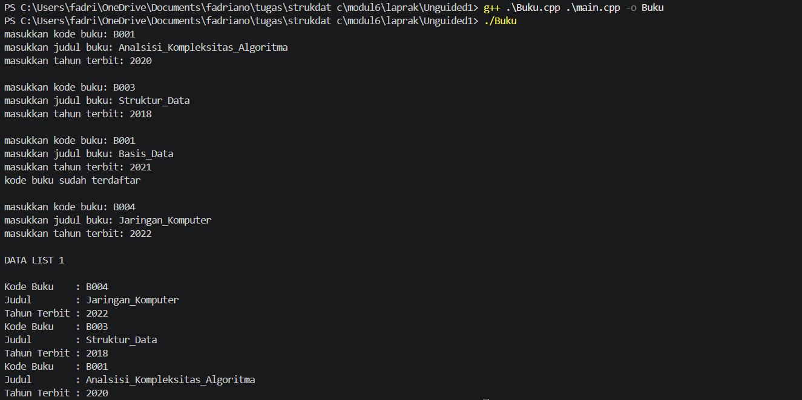
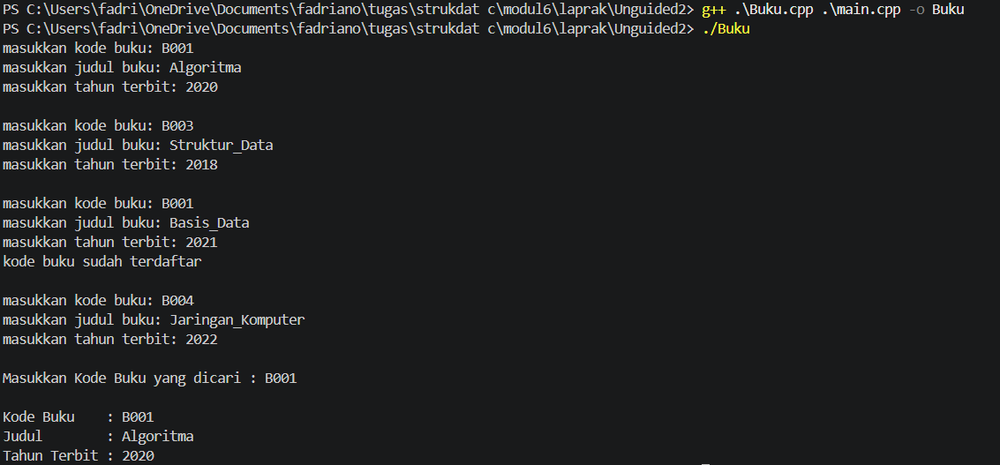
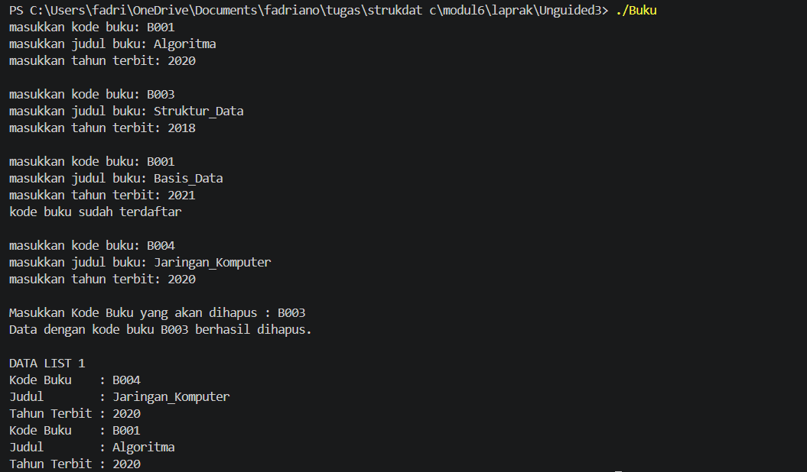

# <h1 align="center">Laporan Praktikum Modul 6 Struktur Data </h1>
<p align="center">Fadriano Bumindra Abiyyu - 109082500170</p>

## Dasar Teori
### A. Doubly Linked List <br/>
Doubly linked list adalah linked list yang setiap elemenya memiliki dua pointer, yaitu prev yang menunjuk elemen sebelumnya dan next yang menunjuk elemen sesudahnya[3]. Dengan dua pointer ini, penelusuran dapat dilakukan secara maju dan mundur[2].
#### 1. First dan Last
First menunjuk elemen pertama list, sedangkan last menunjuk elemen terakhir list[3].
#### 2. Prev dan Next
Prev menghubungkan elemen ke elemen sebelumnya, sedangkan next menghubungkan elemen ke elemen setelahnya[3].
### B. Operasi Dasar <br/>
Operasi dasar doubly linked list meliputi insert, delete, dan searching[1][2].
#### 1. Insert
Penambahan elemen dapat dilakukan di awal (insert first), di akhir (insert last), atau setelah elemen tertentu (insert after)[3].
#### 2. Delete
Penghapusan elemen dapat dilakukan pada elemen pertama (delete first), terakhir (delete last), atau seteleah elemen tertentu (delete after)[3].
## Guided 

### Doublylist.h 

```C++
#ifndef DOUBLYLIST_H
#define DOUBLYLIST_H

#include <iostream>
#include <string>

#define Nil NULL

// Latihan 1
struct infotype {
    std::string nopol; 
    std::string warna; 
    int thnBuat;      
};
typedef struct elmlist *address;
struct elmlist {
    infotype info;  
    address next;   
    address prev;   
};
struct List {
    address First; 
    address Last;  
};


// Latihan 1
void CreateList(List &L);
address alokasi(infotype x);
void dealokasi(address &P);
void printInfo(List L);
void insertLast(List &L, address P);

// Latihan 2

address findElm(List L, std::string nopol);

// Latihan 3
void deleteFirst(List &L, address &P);
void deleteLast(List &L, address &P);
void deleteAfter(List &L, address Prec, address &P);
void deleteElm(List &L, std::string nopol, bool &status);

#endif
```
Kode tersebut berisi definisi tipe data yang dipakai doubly linked list. Struct infotype menyimpan nopol, warna, dan thnBuat, struct elmlist adalah node dengan info dan serta pointer next dan prev, dan struct List memiliki pointer First dan Last. File ini juga memuat deklarasi prosedur dan fungsi untuk membuat list, menambah, mencari, dan menghapus elemen.

### Doublylist.cpp 

```C++
#include "Doublylist.h"

// Latihan 1
void CreateList(List &L) {
    L.First = Nil;
    L.Last = Nil;
}

address alokasi(infotype x) {
    address P = new elmlist;
    P->info = x;
    P->next = Nil;
    P->prev = Nil; 
    return P;
}

void dealokasi(address &P) {
    delete P;
}

void printInfo(List L) {
    address P = L.Last;
    if (P == Nil) {
        std::cout << "List kosong." << std::endl;
        return;
    }
    while (P != Nil) {
        std::cout << "no polisi : " << P->info.nopol << std::endl;   
        std::cout << "warna     : " << P->info.warna << std::endl;   
        std::cout << "tahun     : " << P->info.thnBuat << std::endl; 
        P = P->prev;
    }
}

void insertLast(List &L, address P) {
    if (L.First == Nil) { 
        L.First = P;
        L.Last = P;
    } else {
        P->prev = L.Last;         
        (L.Last)->next = P;     
        L.Last = P;               
    }
}

// Latihan 2
address findElm(List L, std::string nopol) {
    address P = L.First;
    while (P != Nil) {
        if (P->info.nopol == nopol) {
            return P;
        }
        P = P->next;
    }
    return Nil;
}

// Latihan 3
void deleteFirst(List &L, address &P) {
    if (L.First == Nil) return;

    P = L.First; 
    if (L.First == L.Last) { 
        L.First = Nil;
        L.Last = Nil;
    } else {
        L.First = P->next;     
        (L.First)->prev = Nil; 
        P->next = Nil;         
    }
}

void deleteLast(List &L, address &P) {
    if (L.First == Nil) return;

    P = L.Last; 
    if (L.First == L.Last) { 
        L.First = Nil;
        L.Last = Nil;
    } else {
        L.Last = P->prev;      
        (L.Last)->next = Nil; 
        P->prev = Nil;         
    }
}

void deleteAfter(List &L, address Prec, address &P) {
    if (Prec == Nil || Prec->next == Nil) return;

    P = Prec->next;
    if (P == L.Last) {
        deleteLast(L, P);
    } else {
        Prec->next = P->next;     
        (P->next)->prev = Prec; 
        P->next = Nil;            
        P->prev = Nil;           
    }
}

void deleteElm(List &L, std::string nopol, bool &status) {
    address P = findElm(L, nopol);
    status = false;

    if (P != Nil) {
        if (P == L.First) {
            deleteFirst(L, P);
        } else if (P == L.Last) {
            deleteLast(L, P);
        } else {
            address Prec = P->prev;
            deleteAfter(L, Prec, P);
        }
        dealokasi(P); 
        status = true;
    }
}
```
Kode tersebut berisi implementasi atau logika pemrograman dari fungsi dan prosedur yang dideklarasikan di header. insertLast menyambung elemen baru ke belakang list lewat pointer Last, findElm menelusuri list dari First untuk mencari nomor polisi dan deleteFirst, deleteLast, dan deleteAfter melepas elemen sambil memperbarui pointer next dan prev. Prosedur deleteElm memilih jenis penghapusan sesuai posisi elemen, sedangkan printInfo menampilkan data dari elemen terakhir ke belakang.

### main.cpp 

```C++
#include <iostream>
#include "Doublylist.h"
using namespace std;

void inputData(List &L) {
    infotype data;
    address P;

    cout << "masukkan nomor polisi: "; cin >> data.nopol;
    cout << "masukkan warna kendaraan: "; cin >> data.warna;
    cout << "masukkan tahun kendaraan: "; cin >> data.thnBuat;
    if (findElm(L, data.nopol) == Nil) {
        P = alokasi(data); 
        insertLast(L, P);  
    } else {
        cout << "nomor polisi sudah terdaftar" << endl; 
    }
}

int main() {
    List L;
    CreateList(L); 
    address P;

    // Latihan 1
    inputData(L); 
    inputData(L); 
    inputData(L); 
    inputData(L); 

    cout << "\nDATA LIST 1" << endl; 
    printInfo(L); 

    // Latihan 2
    string nopolCari;
    cout << "\nMasukkan Nomor Polisi yang dicari : "; 
    cin >> nopolCari; 
    
    P = findElm(L, nopolCari); 
    if (P != Nil) {
        cout << "Nomor Polisi : " << P->info.nopol << endl; 
        cout << "Warna        : " << P->info.warna << endl; 
        cout << "Tahun        : " << P->info.thnBuat << endl; 
    } else {
        cout << "Data dengan nomor polisi " << nopolCari << " tidak ditemukan." << endl;
    }

    // Latihan 3
    string nopolHapus;
    bool hapusBerhasil;
    cout << "\nMasukkan Nomor Polisi yang akan dihapus : ";
    cin >> nopolHapus;

    deleteElm(L, nopolHapus, hapusBerhasil); 

    if (hapusBerhasil) {
        cout << "Data dengan nomor polisi " << nopolHapus << " berhasil dihapus." << endl; 
    } else {
        cout << "Data dengan nomor polisi " << nopolHapus << " tidak ditemukan." << endl;
    }
    cout << "\nDATA LIST 1" << endl; 
    printInfo(L); 

    return 0;
}
```
Kode tersebut berisi program utama yang meminta input data kendaraan sebanyak empat kali lewat inputData, dengan pengecekan agar nomor polisi tidak ganda. Setelah itu program menampilkan isi list, mencari data berdasarkan nomor polisi, menghapus data berdasarkan nomor polisi, lalu menampilkan list sekali lagi.

## Unguided 

### 1.  Buatlah ADT Doubly Linked List di dalam file "Buku.h". Buatlah implementasi ADT Doubly Linked List pada file “Buku.cpp" dan cobalah hasil implementasi ADT tersebut pada file "main.cpp". Pastikan sistem melakukan pengecekan duplikasi kodeBuku sebelum memasukkan data baru ke dalam list.

### Buku.h

```C++
#ifndef BUKU_H
#define BUKU_H
#define Nil NULL

#include <iostream>
#include <string>
using namespace std;

struct buku {
    string kodeBuku;
    string judul;
    int thnTerbit;
};

typedef buku infotype;
typedef struct ElmList *address;

struct ElmList {
    infotype info;
    address next;
    address prev;
};
struct List {
    address First;
    address Last;
};
void CreateList(List &L);
address alokasi(infotype x);
void dealokasi(address &P);
void printInfo(List L);
void insertLast(List &L, address P);
bool kodeSudahAda(List L, string kode);

#endif
```
### Buku.cpp 

```C++
#include "Buku.h"

void CreateList(List &L) {
    L.First = Nil;
    L.Last = Nil;
}
address alokasi(infotype x) {
    address P = new ElmList;
    P->info = x;
    P->next = Nil;
    P->prev = Nil;
    return P;
}
void dealokasi(address &P) {
    delete P;
    P = Nil;
}
void printInfo(List L) {
    address P = L.Last;
    while (P != Nil) {
        cout << "Kode Buku    : " << P->info.kodeBuku << endl;
        cout << "Judul        : " << P->info.judul << endl;
        cout << "Tahun Terbit : " << P->info.thnTerbit << endl;
        P = P->prev;
    }
}
void insertLast(List &L, address P) {
    if (L.First == Nil) {
        L.First = P;
        L.Last = P;
    } else {
        P->prev = L.Last;
        L.Last->next = P;
        L.Last = P;
    }
}
bool kodeSudahAda(List L, string kode) {
    address P = L.First;
    while (P != Nil) {
        if (P->info.kodeBuku == kode) {
            return true;
        }
        P = P->next;
    }
    return false;
}
```
### main.cpp

```C++
#include "Buku.h"

int main() {
    List L;
    CreateList(L);

    int jumlah = 0;
    while (jumlah < 3) {
        infotype x;
        cout << "masukkan kode buku: ";
        cin >> x.kodeBuku;
        cout << "masukkan judul buku: ";
        cin >> x.judul;
        cout << "masukkan tahun terbit: ";
        cin >> x.thnTerbit;

        if (kodeSudahAda(L, x.kodeBuku)) {
            cout << "kode buku sudah terdaftar" << endl;
        } else {
            insertLast(L, alokasi(x));
            jumlah++;
        }
        cout << endl;
    }

    cout << "DATA LIST 1" << endl << endl;
    printInfo(L);
    return 0;
}
```

### Output Unguided 1 :
masukkan kode buku: B001
masukkan judul buku: Analsisi_Kompleksitas_Algoritma
masukkan tahun terbit: 2020

masukkan kode buku: B003
masukkan judul buku: Struktur_Data
masukkan tahun terbit: 2018

masukkan kode buku: B001
masukkan judul buku: Basis_Data
masukkan tahun terbit: 2021
kode buku sudah terdaftar

masukkan kode buku: B004
masukkan judul buku: Jaringan_Komputer
masukkan tahun terbit: 2022

DATA LIST 1

Kode Buku    : B004
Judul        : Jaringan_Komputer
Tahun Terbit : 2022
Kode Buku    : B003
Judul        : Struktur_Data
Tahun Terbit : 2018
Kode Buku    : B001
Judul        : Analsisi_Kompleksitas_Algoritma
Tahun Terbit : 2020

##### Output 1


Kode tersebut membuat ADT doubly linked list untuk data buku, dengan struct buku yang berisi kodeBuku, judul, dan thnTerbit. Fungsi kodeSudahAda menelusuri list untuk memeriksa apakah kode buku sudah ada, dan data baru hanya ditambahkan dengan insertLast jika belum terdaftar. Program berhenti setelah tiga buku tersimpan, lalu printInfo menampilkan data dari elemen terakhir.

### 2. Carilah elemen dengan kode buku B001 dengan membuat fungsi baru findElm(L : List, x : infotype) : address.

### Buku.h

```C++
#ifndef BUKU_H
#define BUKU_H
#define Nil NULL

#include <iostream>
#include <string>
using namespace std;

struct buku {
    string kodeBuku;
    string judul;
    int thnTerbit;
};

typedef buku infotype;
typedef struct ElmList *address;

struct ElmList {
    infotype info;
    address next;
    address prev;
};

struct List {
    address First;
    address Last;
};

void CreateList(List &L);
address alokasi(infotype x);
void dealokasi(address &P);
void printInfo(List L);
void insertLast(List &L, address P);
bool kodeSudahAda(List L, string kode);
address findElm(List L, infotype x);

#endif
```
### Buku.cpp
```C++
#include "Buku.h"

void CreateList(List &L) {
    L.First = Nil;
    L.Last = Nil;
}

address alokasi(infotype x) {
    address P = new ElmList;
    P->info = x;
    P->next = Nil;
    P->prev = Nil;
    return P;
}

void dealokasi(address &P) {
    delete P;
    P = Nil;
}

void printInfo(List L) {
    address P = L.Last;
    while (P != Nil) {
        cout << "Kode Buku    : " << P->info.kodeBuku << endl;
        cout << "Judul        : " << P->info.judul << endl;
        cout << "Tahun Terbit : " << P->info.thnTerbit << endl;
        P = P->prev;
    }
}

void insertLast(List &L, address P) {
    if (L.First == Nil) {
        L.First = P;
        L.Last = P;
    } else {
        P->prev = L.Last;
        L.Last->next = P;
        L.Last = P;
    }
}

bool kodeSudahAda(List L, string kode) {
    address P = L.First;
    while (P != Nil) {
        if (P->info.kodeBuku == kode) {
            return true;
        }
        P = P->next;
    }
    return false;
}

address findElm(List L, infotype x) {
    address P = L.First;
    while (P != Nil) {
        if (P->info.kodeBuku == x.kodeBuku) {
            return P;
        }
        P = P->next;
    }
    return Nil;
}
```
### main.cpp

```C++
#include "Buku.h"

int main() {
    List L;
    CreateList(L);

    int jumlah = 0;
    while (jumlah < 3) {
        infotype x;
        cout << "masukkan kode buku: ";
        cin >> x.kodeBuku;
        cout << "masukkan judul buku: ";
        cin >> x.judul;
        cout << "masukkan tahun terbit: ";
        cin >> x.thnTerbit;

        if (kodeSudahAda(L, x.kodeBuku)) {
            cout << "kode buku sudah terdaftar" << endl;
        } else {
            insertLast(L, alokasi(x));
            jumlah++;
        }
        cout << endl;
    }

    infotype cari;
    cout << "Masukkan Kode Buku yang dicari : ";
    cin >> cari.kodeBuku;

    address P = findElm(L, cari);
    if (P != Nil) {
        cout << endl;
        cout << "Kode Buku    : " << P->info.kodeBuku << endl;
        cout << "Judul        : " << P->info.judul << endl;
        cout << "Tahun Terbit : " << P->info.thnTerbit << endl;
    } else {
        cout << "Buku dengan kode " << cari.kodeBuku << " tidak ditemukan." << endl;
    }
    return 0;
}
```

### Output Unguided 2 :
masukkan kode buku: B001
masukkan judul buku: Algoritma
masukkan tahun terbit: 2020

masukkan kode buku: B003
masukkan judul buku: Struktur_Data
masukkan tahun terbit: 2018

masukkan kode buku: B001
masukkan judul buku: Basis_Data
masukkan tahun terbit: 2021
kode buku sudah terdaftar

masukkan kode buku: B004
masukkan judul buku: Jaringan_Komputer
masukkan tahun terbit: 2022

Masukkan Kode Buku yang dicari : B001

Kode Buku    : B001
Judul        : Algoritma
Tahun Terbit : 2020
##### Output 2


Kode tersebut menambahkan fungsi findElm yang menelusuri list dari First dan membandingkan kodeBuku setiap elemen dengan kode yang dicari. Fungsi mengembalikan alamat elemen jika ditemukan, atau Nil jika tidak ada. Pada main, jika alamatnya bukan Nil, kode buku, judul, dan tahun terbit ditampilkan.

### 3. Hapus elemen dengan kode buku B003 dengan membuat prosedur deleteFirst, deleteLast, dan deleteAfter.

### Buku.h

```C++
#ifndef BUKU_H
#define BUKU_H
#define Nil NULL

#include <iostream>
#include <string>
using namespace std;

struct buku {
    string kodeBuku;
    string judul;
    int thnTerbit;
};

typedef buku infotype;
typedef struct ElmList *address;

struct ElmList {
    infotype info;
    address next;
    address prev;
};

struct List {
    address First;
    address Last;
};

void CreateList(List &L);
address alokasi(infotype x);
void dealokasi(address &P);
void printInfo(List L);
void insertLast(List &L, address P);
bool kodeSudahAda(List L, string kode);
address findElm(List L, infotype x);
void deleteFirst(List &L, address &P);
void deleteLast(List &L, address &P);
void deleteAfter(address Prec, address &P);

#endif
```

### Buku.cpp

```C++
#include "Buku.h"

void CreateList(List &L) {
    L.First = Nil;
    L.Last = Nil;
}

address alokasi(infotype x) {
    address P = new ElmList;
    P->info = x;
    P->next = Nil;
    P->prev = Nil;
    return P;
}

void dealokasi(address &P) {
    delete P;
    P = Nil;
}

void printInfo(List L) {
    address P = L.Last;
    while (P != Nil) {
        cout << "Kode Buku    : " << P->info.kodeBuku << endl;
        cout << "Judul        : " << P->info.judul << endl;
        cout << "Tahun Terbit : " << P->info.thnTerbit << endl;
        P = P->prev;
    }
}

void insertLast(List &L, address P) {
    if (L.First == Nil) {
        L.First = P;
        L.Last = P;
    } else {
        P->prev = L.Last;
        L.Last->next = P;
        L.Last = P;
    }
}

bool kodeSudahAda(List L, string kode) {
    address P = L.First;
    while (P != Nil) {
        if (P->info.kodeBuku == kode) {
            return true;
        }
        P = P->next;
    }
    return false;
}

address findElm(List L, infotype x) {
    address P = L.First;
    while (P != Nil) {
        if (P->info.kodeBuku == x.kodeBuku) {
            return P;
        }
        P = P->next;
    }
    return Nil;
}

void deleteFirst(List &L, address &P) {
    P = L.First;
    if (P == Nil) {
        return;
    }
    if (L.First == L.Last) {
        L.First = Nil;
        L.Last = Nil;
    } else {
        L.First = P->next;
        L.First->prev = Nil;
        P->next = Nil;
    }
}

void deleteLast(List &L, address &P) {
    P = L.Last;
    if (P == Nil) {
        return;
    }
    if (L.First == L.Last) {
        L.First = Nil;
        L.Last = Nil;
    } else {
        L.Last = P->prev;
        L.Last->next = Nil;
        P->prev = Nil;
    }
}

void deleteAfter(address Prec, address &P) {
    P = Prec->next;
    Prec->next = P->next;
    P->next->prev = Prec;
    P->next = Nil;
    P->prev = Nil;
}
```
### main.cpp
```C++
#include "Buku.h"

int main() {
    List L;
    CreateList(L);

    int jumlah = 0;
    while (jumlah < 3) {
        infotype x;
        cout << "masukkan kode buku: ";
        cin >> x.kodeBuku;
        cout << "masukkan judul buku: ";
        cin >> x.judul;
        cout << "masukkan tahun terbit: ";
        cin >> x.thnTerbit;

        if (kodeSudahAda(L, x.kodeBuku)) {
            cout << "kode buku sudah terdaftar" << endl;
        } else {
            insertLast(L, alokasi(x));
            jumlah++;
        }
        cout << endl;
    }

    infotype hapus;
    cout << "Masukkan Kode Buku yang akan dihapus : ";
    cin >> hapus.kodeBuku;

    address P = findElm(L, hapus);
    if (P == Nil) {
        cout << "Buku dengan kode " << hapus.kodeBuku << " tidak ditemukan." << endl;
        return 0;
    }

    if (P == L.First) {
        deleteFirst(L, P);
    } else if (P == L.Last) {
        deleteLast(L, P);
    } else {
        deleteAfter(P->prev, P);
    }
    dealokasi(P);
    cout << "Data dengan kode buku " << hapus.kodeBuku << " berhasil dihapus." << endl << endl;

    cout << "DATA LIST 1" << endl;
    printInfo(L);
    return 0;
}
```

### Output Unguided 3 :
masukkan kode buku: B001
masukkan judul buku: Algoritma
masukkan tahun terbit: 2020

masukkan kode buku: B003
masukkan judul buku: Struktur_Data
masukkan tahun terbit: 2018

masukkan kode buku: B001
masukkan judul buku: Basis_Data
masukkan tahun terbit: 2021
kode buku sudah terdaftar

masukkan kode buku: B004
masukkan judul buku: Jaringan_Komputer
masukkan tahun terbit: 2020

Masukkan Kode Buku yang akan dihapus : B003
Data dengan kode buku B003 berhasil dihapus.

DATA LIST 1
Kode Buku    : B004
Judul        : Jaringan_Komputer
Tahun Terbit : 2020
Kode Buku    : B001
Judul        : Algoritma
Tahun Terbit : 2020
##### Output 3


Kode tersebut menambahkan prosedur deleteFirst, deleteLast, dan deleteAfter untuk menghapus elemen sesuai posisinya sambil memperbarui pointer next dan prev. Pada main, elemen dicari dengan findElm lalu dihapus dengan prosedur yang sesuai. Karena B003 berada di tengah list, yang dipakai adalah deleteAfter, lalu dealokasi membebaskan memorinya dan list ditampilkan kembali.

## Kesimpulan
Doubly linked list memiliki pointer prev dan next sehingga elemen dapat diakses maju maupun mundur. Operasi insert, delete, dan searching dilakukan dengan mengatur kedua pointer tersebut.

## Referensi
[1] Setiyawan, R. D., Hermawan, D., Abdillah, A. F., Mujayanah, A., & Vindua, R. (2024). "Penggunaan Struktur Data Stack dalam Pemrograman C++ dengan Pendekatan Array dan Linked List". JUTECH: Journal Education and Technology, Vol. 5, No. 2, Desember 2024, hlm. 484-498. DOI: https://doi.org/10.31932/jutech.v5i2.4263. Diakses pada 1 November 2026 melalui https://jurnal.stkippersada.ac.id/jurnal/index.php/jutech/article/view/4263. <br> 
[2] Wijoyo, A., Farhan, A., Prayudi, L. A., Fiqih, M., Santoso, R. D., Putra, R. T. S., & Arifin, T. (2024). "Penggunaan Algoritma Doubly Linked List Untuk Insertion Dan Deletion". JRIIN: Jurnal Riset Informatika dan Inovasi, Vol. 1, No. 12, hlm. 1329-1331. Diakses pada 1 November 2026 melalui https://jurnalmahasiswa.com/index.php/jriin/article/view/1282. <br> 
[3] Fakultas Informatika, Telkom University. (n.d.). "Modul 6: Doubly Linked List (Bagian Pertama)". Modul Praktikum Struktur Data. Informatics Lab.